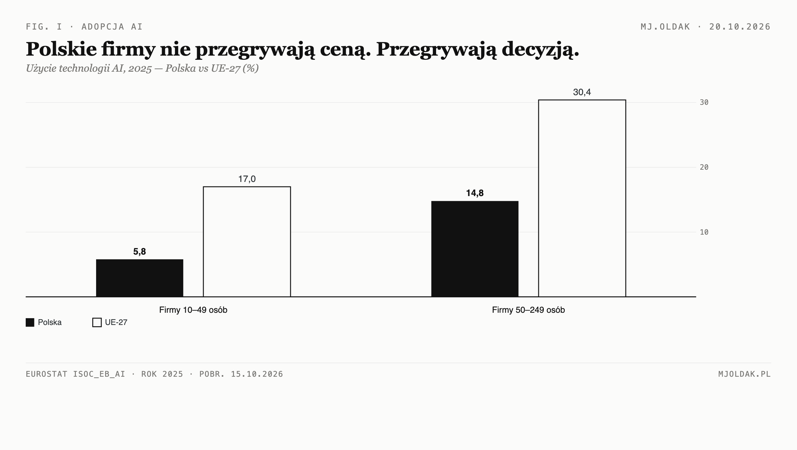

# Nie zastępuję ludzi. Wdrażam i uczę AI w Twojej firmie.

*Buduję rozwiązania wokół Twojego procesu, nie sprzedaję gotowca. Automatyzacja jest efektem ubocznym produktywności, nie celem samym w sobie.*

## Dlaczego większość firm jeszcze nie używa AI

To nie jest problem ceny ani dostępu do narzędzi. Dane Eurostatu za 2025 rok pokazują, że polskie firmy nie odpadają z powodu kosztów — odpadają, zanim w ogóle zaczną rozważać zastosowanie:

| Wskaźnik (2025) | Polska | UE |
|---|---|---|
| Firmy 10–49 osób używające AI | **5,8%** | 17,0% |
| Firmy 50–249 osób używające AI | **14,8%** | 30,4% |
| Bariery: „koszt wydaje się za wysoki” (10–49) | 1,8% | 4,0% |
| Firmy, które rozważały użycie AI (10–49) | **3,4%** | 10,2% |

*Źródło: Eurostat, zbiór isoc_eb_ai, rok referencyjny 2025, pobrany 15.10.2026: https://ec.europa.eu/eurostat/api/dissemination/statistics/1.0/data/isoc_eb_ai*

Największa luka nie jest tam, gdzie najłatwiej ją tłumaczyć brakiem pieniędzy — jest w średnich firmach (50–249 osób: −15,6 pkt proc. wobec UE), czyli u przedsiębiorców, którzy już mają budżet i zespół. Przyczyna nie jest w portfelu. Jest w tym, czy ktokolwiek w firmie zadał sobie pytanie: do czego to moglibyśmy użyć — i czy ktoś ten zespół tego nauczył. To jest kwestia wiedzy i decyzji, nie pieniędzy.

## Co robię

Cel nie jest automatyzacja sama w sobie. Jest nim produktywność: mniej czasu na rzeczy powtarzalne, więcej na to, co wymaga Twojego osądu. Automatyzacja jest efektem ubocznym — przychodzi sama, gdy proces i narzędzia są już dobrze ułożone.

**1. Automatyzuję powtarzalną pracę.**

Przykład procesu faktur wygląda tak: odczyt danych z PDF, przygotowanie wpisu do systemu, wyjątki lądują u Ciebie do zatwierdzenia. Przykład e-maila: szkic odpowiedzi na bazie szablonu, wysyłka po Twojej akceptacji. Arkusze: przenoszenie danych między plikami bez ręcznego przepisywania. Wdrażam wokół tego, co firma już robi — po polsku, z uwzględnieniem KSeF i JPK. Jeśli praca wymaga osądu — zostaje u ludzi.

**2. Nauka Twojego zespołu — na Waszych zadaniach.**

Pracujemy na rzeczywistych zadaniach i w Waszych narzędziach, nie na przykładach z internetu. Pokazuję na Waszym przykładzie → robimy razem na realnym zadaniu → pracujesz sam przy moim wsparciu.

Nie sprzedaję kursu — każda firma ma innych ludzi i inne procesy, gotowy pakiet by się nie przydał. Uczę indywidualnie na Waszych zadaniach.

**3. Analizy wspierające decyzje.**

GUS, Eurostat, Twoje wewnętrzne dane — z podanym źródłem i rokiem. Przekuwam je w tekst, nie w kolejny panel do logowania — materiał do rozmowy z właścicielem i zespołem. Cel jeden: konkret, na którym da się oprzeć decyzję.

## Jak pracuję — cztery zasady

- **Człowiek decyduje.** AI proponuje, Ty zatwierdzasz — żadna automatyzacja nie działa bez Twojej zgody, a żaden dokument do urzędu nie wychodzi z budowanego układu bez Twojej akceptacji.
- **Dane pod kontrolą.** RODO, umowa powierzenia przetwarzania (DPA), dane nie trafiają do usług bez umowy.
- **Ślad decyzji.** Wiadomo co zostało zrobione, kiedy i na jakiej podstawie — audytowalne od pierwszego dnia.
- **Bez uzależnienia.** Narzędzia, które da się utrzymać bez własnego działu IT i bez abonamentowego koła zamachowego. Zakres i koszt są proporcjonalne do problemu, nie do długości prezentacji.

## Dla kogo to ma sens — i dla kogo nie

**Tak, jeśli:**
- powtarzalna praca zabiera godziny co tydzień (wpisy, zestawienia, powtarzalna korespondencja);
- firma rośnie ilością zadań, a nie ilością ludzi w zespole;
- zespół chce sam umieć pracować z AI, a nie mieć to zlecone raz na zawsze;
- już próbowałeś gotowych narzędzi i się nie przyjęły.

**Nie, jeśli:**
- szukasz gotowego kursu — uczę indywidualnie na Twoich zadaniach;
- każda sprawa jest unikalna i wymaga ludzkiego osądu — to zostaje u ludzi;
- proces jest w pełni opanowany i nie ma czego poprawiać.

## Jak zaczynamy

Jeden proces, nie cała firma. Najpierw pomiar: ile czasu zajmuje dziś. Potem wdrożenie i nauka w małym zakresie i pomiar po zmianie. Decyzja o rozszerzeniu zapada na faktach — jeśli po pomiarze okaże się, że proces nie opłaca się automatyzować, powiem to wprost. A jeśli warto — zostajesz z zespołem, który umie robić to sam.

**Pierwszy krok: 20 minut rozmowy.** Pokazujesz jeden powtarzalny proces, dostajesz ocenę: co wdrożyć, czego nauczyć zespół, a co zostawić ludziom — z szacunkiem nakładu i kolejności prac. Nawet jeśli odpowiedź brzmi: nie ruszaj tego teraz.

Marcin Ołdak · MJ.OLDAK · mjoldak.pl
