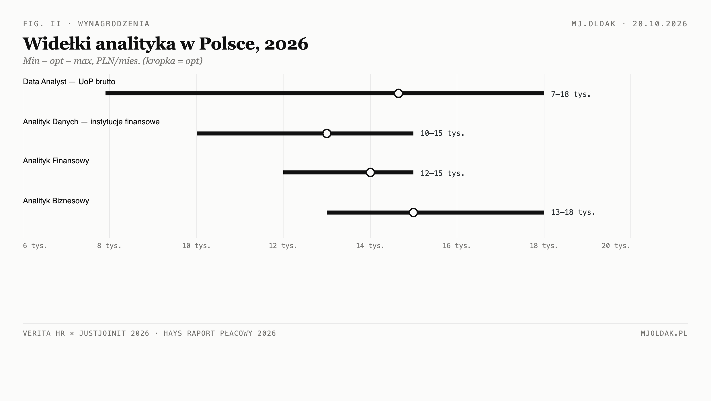

# Stack analityczny: compose vs build + scoring jako umiejętność

*raport oparty na źródłach z OSNOWA/prompts (2026-06–2026-07) + research trends (2026)*

## TL;DR

Po pierwsze, priorytet w budowie osobistego stacka analitycznego powinien paść na **SQL i warstwę domenową** (Polska finansów), a nie na automatyzację pipeline'u — framework „compose over build" wygrywa pod względem nakładu utrzymania przy budżecie zero PLN. Po drugie, systemy scoringowe działają najlepiej, gdy zaczynają się od wag teoretycznie-zależnych równych sobie plus veto gates jako hard constraints POZA score'em, ewoluując ku modelom uczenia maszynowego dopiero po zbiorze oznaczonych etykiet — literatura o improper linear models (Dawes) potwierdza, że prostsze modele liniowe regularnie bije złożone przy małych próbach i niskiej jakości danych etykietujących. Po trzecie, luki pierwotnego draftu domknięto researchem zastępczym 20.10.2026: rynek PL opisują publiczne raporty No Fluff Jobs, Just Join IT, Verita HR, Hays i KNF (Data & BI = 12,4% ogłoszeń NFPJ; Data = 10,78% ofert JustJoin — lider rynku; widełki Data Analyst 7 900–18 000 zł UoP; Analityk Danych w pozostałych instytucjach finansowych 10/13/15 tys. zł; 81% firm finansowo-księgowych planuje rekrutować w 2026), a rekomendacje scaffold-level obejmują wszystkie 11 komponentów pipeline: 8 z nich w wariantzie COMPOSE, 3 w BUILD-CUSTOM (insight-synth, source-claim-validate, monitor w wariancie stdlib). Zostają dwie twarde luki rynkowe — liczba ofert DA/BA wyłącznie w sektorze finansów PL oraz success-rate juniorów — bo żadne dostępne źródło ich nie publikuje [research 20.10.2026].

## 1. Kontekst — czym jest stack i dlaczego pytać o „compose vs build"

Stack analityczny to zestaw reużywalnych narzędzi pokrywających fazę przepływu pracy od pozyskania surowych danych do finalnej publikacji wniosków. W wersji roboczej autor definiuje sześć komponentów: data-acquire → data-validate → data-wrangle → data-analyze → insight-synth → analytical-report. Później rozrastą się do jedenaściou warstw z dodaniem data-versioning, source-claim-validate, stat-validate, decision-report, i monitor-and-maintain [prompts/compose-vs-build, 2026-06-13].

Trzy twarde ograniczenia stanowią filtry selekcji technologicznej:

1. **Budżet = EUR 0 / PLN 0** — żadne płatne SaaS, subskrypcje, free-trap-y, ani managed backend. Użytkownik ma Claude Max plan i Perplexity — wszystko co zewnętrzne musi być lokalnie hostowalne.
2. **Brak DevOps** — zero serwerów VPS, zero daemons/cron-to-babysit, zero always-on schedulers. Coś potrzebuje administracji ≥ raz w miesiącu = auto-disqualified.
3. **Apple Silicon arm64 native** — żaden x86-only tool z Rossetą czy Linux-container-only option.

Dodatkowy wymiar to **literacy flag**: narzędzie nie może zastępować kompetencji sprawdzanych na rozmowach rekrutacyjnych (SQL by ręki, Power BI/DAX, interpretacja testów statystycznych, pandas reasoning). Black-box tool, który robi EDA za Ciebie, jest dobrym demo ale złym nauczycielem. Glass-box transparency jest wymagane [prompts/compose-vs-build, 2026-06-13].

### 1.1 Cztery pytania badawcze pierwszego promptu

Prompt z 13 czerwca 2026 definiuje cztery kluczowe pytania dla Perplexity Deep Research:

1. **Gaps in the plan/pipeline**: czego brakuje? Co pominięto — wersjonowanie danych, walidacja statystyczna, ryzyko bias/cherry-picking, dokumentacja metodyki, etyka danych?
2. **Role gap analysis (market)**: jakie twarde skills są expected TODAY (2025–2026) od Data Analyst / BA w finansach PL/EU, których brakuje w profilu? Must-have vs nice-to-have w ofertach pracy.
3. **Concrete tools to learn**: SQL, Python data stack, wizualizacja/BI, statistyka/econometrii, bazy danych, cloud, domain/regulatory knowledge (KYC/AML, MiFID II, Basel, risk reporting) — priorytetyzowane po roturnie employability.
4. **Data fact-checking**: frameworki, metody i narzędzia do weryfikacji poprawności danych, oceny wiarygodności zrodel, wykrywania dezinformacji — zwłaszcza secondary data [prompts/compose-vs-build, 2026-06-13].

### 1.2 Dwa przebiegi Promptu Scoring

Prompt z 29 lipca został zaprojektowany na dwa przebiegi DR:

- **Prompt A (nauka)**: taksonomia metod scoringowych, pełna metodyka budowy, cold-start, walidacja, czytanie wyniku, tryby awarii, aspekty prawne. Sekcje: taxonomy, full pipeline, cold-start, validation, reading scores, failure modes, when-score-is-wrong-tool, legal-ethical-for-persons, canonical-evidence-base.
- **Prompt B v2 (implementacja)**: architektura referencyjna, biblioteki Python, LLM roles, hybrid designs, code-testing vs validity-validation, human-in-the-loop feedback, presentation layer, staged plan.

Oba odpalone, wyniki zapisane w pliku jako output summaries z tuning notes [prompts/scoring, 2026-07-29].

## 2. Stack analityczny rekomendowany — wnioski z promptów

### 2.1 Framework CLONE / COMPOSE / BUILD-CUSTOM

Prompt compose-vs-build wprowadza framework oceny każdej warstwy pipeline'u jako:

- **CLONE** — adoptuj gotowy projekt/scaffold (np. cookiecutters, end-to-end templates). Niszczy ryzyko reinwentowania szkicu, ale wymaga ostrożności literacy flag: czy narzędzie zastępuje kompetencję, która powinna być Twoja.
- **COMPOSE** — łącz kanoniczne biblioteki przez szablon glue (np. pandera + Great Expectations + statsmodels). Wymaga świadomości jakie łączenie się robi.
- **BUILD-CUSTOM** — uzasadnione TYLKO dla różnicownika: (i) warstwa orkiestracji głosowej Claude'a jako cel dydaktyczny, (ii) warstwa domenowa PL-finance (NBP/GUS/GPW connectory, definicje KYC/AML/MiFID II/Basel). Każde BUILD-CUSTOM spoza tego zakresu musi wykazać brak OSS prior-art.

Priorytet umiejętności (ustalony z góry w prompt): **SQL = #1 must-have**, potem Power BI/DAX, Excel, pandas, statystyki, domain knowledge bankowy. Każdy komponent stacka jest oznaczany `BYPASS-RISK` jeśli kradnie literaturę rekrutera [prompts/compose-vs-build, 2026].

### 2.2 Scoring — metodaologia potwierdzona z DR

Dokument scoring dostarcza solidny rdzeń metodologiczny z czterema zastrzeżeniami:

| Aspekt | Ustalenie | Źródło |
|---|---|---|
| Model v1 | theory-driven additive weighted-sum + veto gates POZA score'em | DR Output A, Dawes literature |
| Wagi początkowe | równe/wariacje expert-elicited — equal weights beats complex (improper linear models) | Dawes; Siddiqi credit-scoring tradition |
| Missing values | neutralny wkład + flaga, nigdy penalty — WOE-style | DR Output B |
| Cold-start | Bayesian shrinkage dopiero gdy przybędzie etykiet | DR Output A + B |
| Walidacja | Monte Carlo sensitivity over weight vectors + Spearman rank-stability | JRC composite-indicator methodology |

Krytyka DR: progi PSI 0.1/0.25 i IV 0.02/0.1/0.3 to konwencje branżowe bez mocnego uzasadnienia teoretycznego — muszą być flagowane jako `[industry convention]`, nie `[peer-reviewed]`. Goodhart's law transfer z credit-scoringu do scoringu ofert jest błędem domenowym (offer market nie ma agent-gaming). Reguła EPV≥10 uznana za uproszczoną przez van Smeden/riley (2019) [prompts/scoring, 2026].

### 2.3 Architektura referencyjna

Z promptu B wynika struktura modułowa:

```
scoring-core/
├── config.yaml          # indicators, weights, thresholds, vetoes
├── extractors/          # per-domain feature extraction
├── scorer.py            # deterministic core (additive weighted sum)
├── validators/          # MC sensitivity, rank stability
└── explanations/        # per-item contribution breakdown
```

Wagi i cutoff'y są versioned configuration data, nie code [prompts/scoring, 2026].

## 3. Luki i ryzyka

### 3.1 Rynek PL: dane po research zastępczym (20.10.2026)

Oryginalny prompt DR (2026-06-13) nie został odpalony. Poniższe dane pochodzą z publicznych raportów branżowych odczytanych 20.10.2026 — każda liczba ma źródło i rok; substytut promptu, nie jego realizacja.

**Struktura popytu (2025–2026):**

| Metryka | Wartość | Źródło |
|---|---|---|
| Data & BI w ogłoszeniach NFPJ | 12,4% — 2. kategoria po Backendzie (20,1%) | [NFPJ, 2025] |
| Data na Just Join IT | 10,78% wszystkich ofert — lider przed JavaScript (9,57%) i Javą (9,46%) | [JJIT, 2026] |
| Python w ogłoszeniach NFPJ | wzrost o ~8 p.p. w ciągu 4,5 roku (napęd: AI i automatyzacja); SQL trzyma pozycję | [NFPJ, 2026] |
| Najczęściej wymagane narzędzia DA (ogłoszenia globalne, analiza 1 000 ofert) | Excel 41,3% · Tableau 28,1% · Power BI 24,7% | [365 Data Science, 2025] |

**Wynagrodzenia (PLN/mies.):**

| Stanowisko | Min / Opt / Max | Źródło |
|---|---|---|
| Data Analyst — UoP brutto (junior/mid/senior) | 7 900 / 14 645 / 18 000 | [Verita HR × JJIT, 2026] |
| Data Analyst — B2B netto (junior/mid/senior) | 10 080 / 19 320 / 22 260 | [Verita HR × JJIT, 2026] |
| Młodszy Analityk Finansowy | 9 000 / 10 000 / 11 000 | [Hays, 2026] |
| Analityk Finansowy | 12 000 / 14 000 / 15 000 | [Hays, 2026] |
| Starszy Analityk Finansowy | 14 000 / 16 000 / 17 000 | [Hays, 2026] |
| Analityk Biznesowy | 13 000 / 15 000 / 18 000 | [Hays, 2026] |
| Analityk Danych — pozostałe instytucje finansowe (leasing, consumer finance, fundusze, domy maklerskie) | 10 000 / 13 000 / 15 000 | [Hays, 2026] |
| Data Scientist (sekcja danych) | 20 000 / 24 000 / 27 000 | [Hays, 2026] |



**Popyt i domena:**

- 81% firm finansowo-księgowych planuje rekrutować w 2026, 44% spodziewa się trudności w rekrutacji, 59% specjalistów rozważa zmianę pracy [Hays, 2026].
- Wymagania domenowe w ogłoszeniach sektora: AML/CFT (ocena ryzyka, STIR), KYC, MiFID II (ochrona klienta, raportowanie transakcji), KSeF/CSRD/ESG, walidacja modeli ryzyka — zakres podmiotów nadzorowanych przez KNF [KNF, 2026; Hays, 2026].

**Czego dalej nie ma (twarde luki):**

- Liczba ofert DA/BA wyłącznie w sektorze finansów PL — żaden raport tego nie publikuje; wymaga bezpośredniego scrapingu portali z filtrem branżowym [brak danych, stan na 20.10.2026].
- Success-rate juniorów (aplikacja → rozmowa → oferta) — nie publikuje go żadne ze sprawdzonych źródeł [brak danych, stan na 20.10.2026].

### 3.2 Rekomendacje scaffold-level — macierz 11 komponentów (20.10.2026)

Filtry selekcji (z §1): 0 PLN, Apple Silicon arm64, bez DevOps, glass-box — kompetencja zostaje u analityka [research 20.10.2026; repozytoria: Źródła 12–20].

| # | Komponent | Kandydaci COMPOSE | Werdykt | BYPASS-RISK |
|---|---|---|---|---|
| 1 | data-acquire | requests, httpx, DuckDB | COMPOSE | niski |
| 2 | data-validate | Great Expectations, pandera, pydantic | COMPOSE | średni — GX deklaratywnie w configu, wymaga zrozumienia dlaczego walidacja istnieje |
| 3 | data-wrangle | pandas, polars, DuckDB | COMPOSE | niski — SQL/pandas to jest kompetencja |
| 4 | data-analyze | scipy, statsmodels, plotly/matplotlib | COMPOSE | niski — glass-box |
| 5 | insight-synth | brak dobrego OSS | BUILD-CUSTOM (szablon + człowiek) | **wysoki dla LLM na finalnym wniosku** — synteza wniosków jest rdzeniem kompetencji |
| 6 | analytical-report | Quarto, R Markdown, Jinja2 | COMPOSE | niski — format, nie analityka |
| 7 | data-versioning | DVC (LakeFS tylko z hostowaniem = DevOps) | COMPOSE | niski |
| 8 | source-claim-validate | brak dedykowanego OSS | BUILD-CUSTOM (skrypt cross-reference API) | n/a — walidacja zostaje ręczna z mechaniką |
| 9 | stat-validate | scipy.stats, diagnostyka statsmodels, pingouin | COMPOSE | niski — interpretacja ręczna |
| 10 | decision-report | Quarto, docxtpl, Pandoc | COMPOSE | niski |
| 11 | monitor-and-maintain | stdlib logging + smtplib; Prefect/Dagster = daemons | COMPOSE wariant zero-DevOps (stdlib) | niski; wariant z Prefect/Dagster łagodnie łamie filter DevOps |

**Rekomendowany scaffold A (zero-DevOps):** struktura cookiecutter-data-science; acquire=requests/DuckDB → validate=pandera → wrangle=polars → analyze=scipy+statsmodels → synth=custom → report=Quarto → version=DVC → claim-validate=custom → stat=scipy → decision=Quarto → monitor=stdlib logging. Wszystko instalable przez pip/quarto CLI, arm64, 0 PLN. Wariant B (Prefect + Great Expectations) odłożony: wygodny, ale wymaga daemons [research 20.10.2026].

Zostaje decyzja projektowa: source-claim-validate i insight-synth to pełny build własny — to nie luka narzędziowa, tylko konsekwencja literacy flag [research 20.10.2026].

### 3.3 Ryzyka metodologiczne istniejące niezależnie od DR

- **Selection bias**: etykiety są obserwowane tylko dla ofert na które Marcin odpowiedział — decydującym czynnikiem jest sam wynik skora. Tryb_missing-not-at-random klasyczny.
- **Overfitting na małej próbie**: zalecane są equal weights + Bayesian shrinkage, ale kalibracja concentration parametru w dirichlet Monte Carlo wymaga testu empirycznego.
- **Kompetencyjne BYPASS**: adopting black-box tool (np. auto-EDA, no-code dashboard) może dać demo, ale niszczy literacy potrzebne na rozmowach rekrutacyjnych.

## 4. Metodyka — co pochodzi z czego

| Element źródła | Typ | Status |
|---|---|---|
| Draft stacka 6-komponentowego | Prompt | ✅ Istnieje, użyty jako ramy |
| CLONE/COMPOSE/BUILD-CUSTOM framework | Prompt | ✅ Istnieje, użyty jako ramy |
| SQL priorytet #1 | Prompt (postanowienie) | ✅ Istnieje |
| Taksonomia metod scoringowych | Prompt A | ✅ Szczegółowy, gotowy do odpalenia |
| Verdykt DR Output A: theory-driven weighted-sum + veto gates | Prompt output note | ✅ Zapisany w pliku scoring |
| Plan 5-etapowej implementacji | Prompt B output note | ✅ Zapisany w pliku scoring |
| Lista bibliotek Python dla each step | Prompt B output note | ✅ Zapisany w pliku scoring |
| Market data PL (oferty, pensje, wymagania) | Research zastępczy 20.10.2026 (NFPJ/JJIT/Verita/Hays/KNF) | ✅ Domknięte; brak: liczby DA/BA w finansach + success-rate |
| Specific scaffold recommendations | Research OSS 20.10.2026 (11 komponentów) | ✅ Domknięte: 8 COMPOSE / 3 BUILD-CUSTOM |
| Research trends 2026: AI agents, local models, inference efficiency | research-trends.pdf | ✅ Used as supplementary context |

## 5. Źródła

1. `2026-06-13 — Perplexity DeepResearch — compose-vs-build stack v2 (prior-art scan)` — prompt do DR, 2026-06-13. OSNOWA/wiedza/prompts/.
2. `2026-07-29 — Perplexity DeepResearch — scoring jako umiejętność (metodyka + implementacja)` — prompt z output summary DR + tuning notes, 2026-07-29. OSNOWA/wiedza/prompts/.
3. `What are the latest research trends in technology and computer science in 2026?` — survey of 2026 literature on AI agents, small/local/on-device LMs, inference efficiency, embodied AI, post-quantum crypto, privacy/security. Compiled ~2026-10-14. Downloads/.
4. `2026-06-13 — PerplexityDeepResearch — stack analityczny + luki roli (finanse)` — Plik promptu. **Nieistniejący na dysku** (No such file). Odniesienie do promptu z 4 pytaniami badawczymi — brak DR output.
5. **No Fluff Jobs — IT Job Market in Poland 2025/2026** (Data & BI 12,4%) — nofluffjobs.com/en/insights/report-it-job-market-in-poland/. [2025]
6. **No Fluff Jobs — IT Career in Poland 2026** (Python +~8 p.p.) — nofluffjobs.com/en/insights/it-career-poland-2026/. [2026]
7. **JustJoin IT — Ogłoszenia o pracę w liczbach** (Data 10,78%) — justjoin.it/raport-wynagrodzen/ogloszenia-o-prace-w-liczbach. [2026]
8. **Verita HR × JustJoin IT — Poland Salary Guide 2026** (widełki Data Analyst) — veritahr.com/poland-salary-guide-2026-it-finance-engineering-pay-benchmarks/. [2026]
9. **Hays Poland — Raport płacowy 2026** (odczyt PDF 20.10.2026; mirror: praca.studentnews.pl/Hays-Poland_Raport-placowy-2026.pdf). [2026]
10. **365 Data Science — Data Analyst Job Outlook** (analiza ogłoszeń: Excel/Tableau/Power BI) — 365datascience.com/career-advice/data-analyst-job-outlook-2025/. [2025]
11. **KNF — zakres nadzoru i wyszukiwarka podmiotów** — knf.gov.pl. [2026]
12. **Great Expectations** — github.com/great-expectations/great_expectations. [2026]
13. **pandera (MIT)** — github.com/unionai-oss/pandera. [2026]
14. **DuckDB (MIT)** — github.com/duckdb/duckdb. [2026]
15. **polars (MIT)** — github.com/pola-rs/polars. [2026]
16. **Quarto** — github.com/quarto-dev/quarto-cli. [2026]
17. **DVC** — github.com/iterative/dvc. [2026]
18. **Prefect (Apache-2.0)** — github.com/PrefectHQ/prefect. [2026]
19. **Dagster (Apache-2.0)** — github.com/dagster-io/dagster. [2026]
20. **cookiecutter-data-science** — github.com/drivendataorg/cookiecutter-data-science. [2026]
